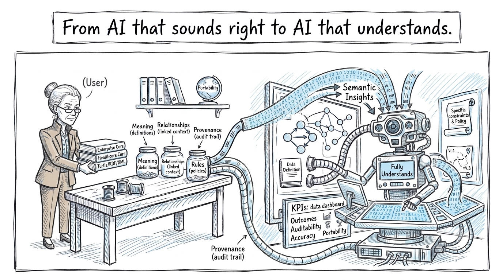
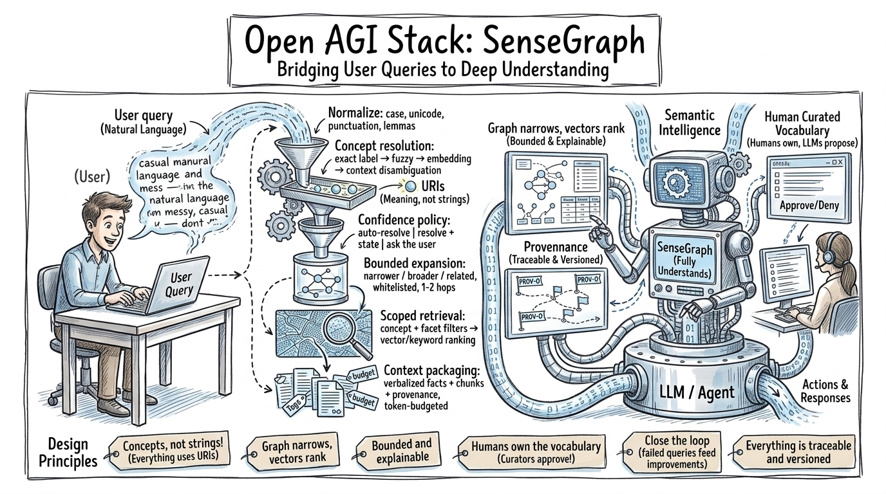

<div align="center">

# Open AGI Stack SenseGraph

### Intelligence into the products

**The Semantic Intelligence layer for enterprise AI**

*From AI that sounds right to AI that understands.*
*Give your AI the context your people already carry.*

[](https://www.openagistack.com/articles/open-agi-stack-semantic-article/)

---

## Overview

Natural human language is messy, casual, and ambiguous. **SenseGraph** translates unstructured user queries into grounded, deterministic **knowledge graphs** and **scoped vector retrieval**, so agents can act on meaning rather than surface text.

Start with ready-made **ontology starter packs** such as **Enterprise Core** and **Healthcare Core**, written in **Turtle** or **RDF/XML**. Then shape them into a semantic intelligence that is fully grounded in your organization's approved vocabulary.

[](https://www.openagistack.com/images/products/semantic-intelligence-sensegraph.png)

---

## Bridging User Queries to Deep Understanding

Most AI systems match text to text. SenseGraph matches **meaning** to **meaning**:

- Raw user input is resolved into unambiguous concepts with persistent URIs.
- The ontology graph defines strict, deterministic boundaries for what is relevant.
- Vector and keyword engines rank results only inside those boundaries.
- Every fact that reaches the model carries provenance, a timestamp, and the active ontology version.

The result is an agent that knows what the user meant, can explain how it got there, and stays inside the vocabulary your domain experts have approved.

---

## Ontology Starter Packs

| Pack | Purpose | Formats |
|------|---------|---------|
| **Enterprise Core** | Foundational concepts shared across organizations | Turtle (`.ttl`), RDF/XML (`.rdf`) |
| **Healthcare Core** | Domain vocabulary for healthcare use cases | Turtle (`.ttl`), RDF/XML (`.rdf`) |

Starter packs are a foundation, not a ceiling. Extend them with your own concepts, synonyms, and relationships until the ontology reflects how your organization actually speaks.

---

## The SenseGraph Engine: From Query to Grounded Action

### 6-Stage Query Understanding Pipeline

| Stage | Name | What it does |
|:-----:|------|--------------|
| **1** | **Normalize** *(String Ingestion)* | Cleans case, applies Unicode normalization, fixes punctuation anomalies, and reduces words to linguistic lemmas from raw human input. |
| **2** | **Concept Resolution** *(Concepts, Not Strings)* | Matches exact labels, synonyms, fuzzy variants, and vector embeddings to resolve inputs into unambiguous, persistent URIs. |
| **3** | **Confidence Policy** *(Tri-State Guardrails)* | Evaluates certainty. High-confidence concepts auto-resolve, medium-confidence concepts come with a stated assumption, and low-confidence concepts are disambiguated by asking the user. |
| **4** | **Bounded Expansion** *(Constrained Traversal)* | Traverses ontology relationships (`narrower`, `broader`, `related`) along whitelisted paths, strictly capped at 1 to 2 hops. |
| **5** | **Scoped Retrieval** *(Graph Narrows, Vectors Rank)* | Applies graph concept and facet boundaries to filter the search space before vector and keyword engines rank relevant chunks. |
| **6** | **Context Packaging** *(Token-Budgeted Grounding)* | Compiles verbalized graph facts, verified text chunks, and PROV-O audit trails into token-budgeted prompt envelopes. |

```text
User query
   │
   ▼
[1] Normalize ──► [2] Concept Resolution ──► [3] Confidence Policy
                                                   │
                     ┌─────────────────────────────┼───────────────────────┐
                     ▼                             ▼                       ▼
                auto-resolve                state assumption          ask the user
                     │                             │
                     └──────────────┬──────────────┘
                                    ▼
                          [4] Bounded Expansion (1–2 hops)
                                    ▼
                          [5] Scoped Retrieval (graph filters, vectors rank)
                                    ▼
                          [6] Context Packaging (facts + chunks + PROV-O)
                                    ▼
                             Grounded agent action
```

---

## SenseGraph Design Principles

### Concepts, Not Strings
Everything resolves to persistent URIs. No more ambiguity between "ATM" (the machine) and "ATM" (the mode).

### Graph Narrows, Vectors Rank
Ontology graphs define strict, deterministic boundaries, while vector search ranks the best matches within them.

### Bounded and Explainable
Predictable, shallow-hop traversals with explicit reasoning paths eliminate runaway hallucinations.

### Humans Own the Vocabulary
LLMs suggest synonyms and mappings, but domain curators have final approve/deny control.

### Close the Loop
Failed query resolutions and unmapped phrases automatically queue up to expand future vocabulary.

### Traceable and Versioned
Every fact retrieved carries its provenance receipt, timestamp, and active ontology version.

---

## Why SenseGraph

| Without SenseGraph | With SenseGraph |
|--------------------|-----------------|
| Matches strings and hopes for the best | Resolves concepts to persistent URIs |
| Search space is the whole corpus | Search space is narrowed by the graph first |
| Unbounded, hard-to-audit reasoning | 1 to 2 hop traversals with explicit paths |
| Vocabulary drifts silently | Curators approve every mapping |
| Misses are lost | Misses feed the vocabulary backlog |
| Answers without receipts | Provenance, timestamp, and ontology version on every fact |

---

## Learn More

- Product page: [openagistack.com](https://go.openagistack.com)

---

**Open AGI Stack SenseGraph** · Semantic Intelligence for enterprise AI

</div>
